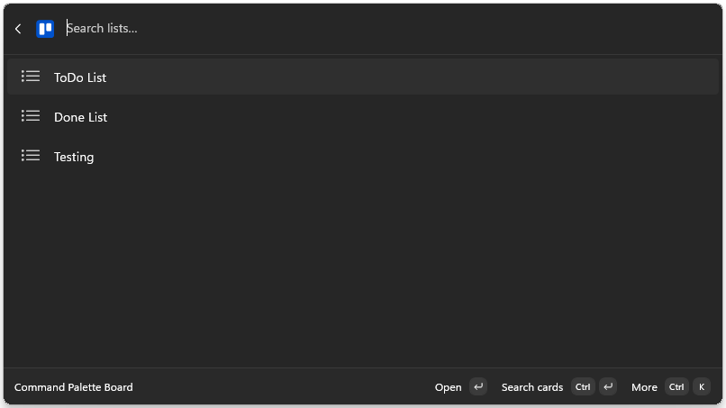
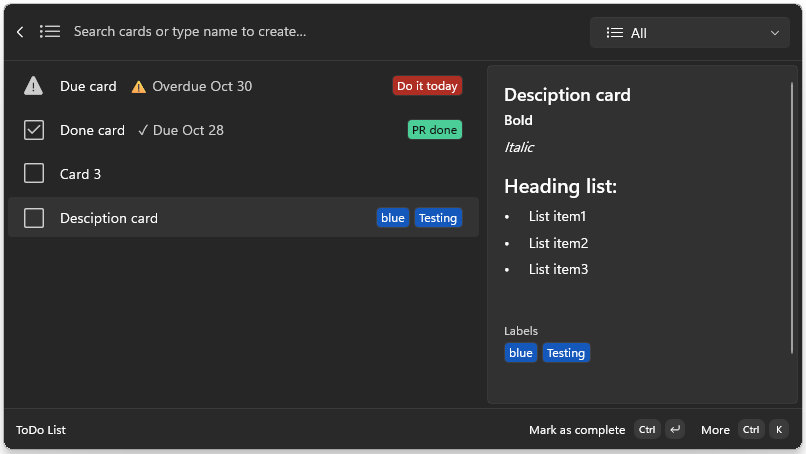
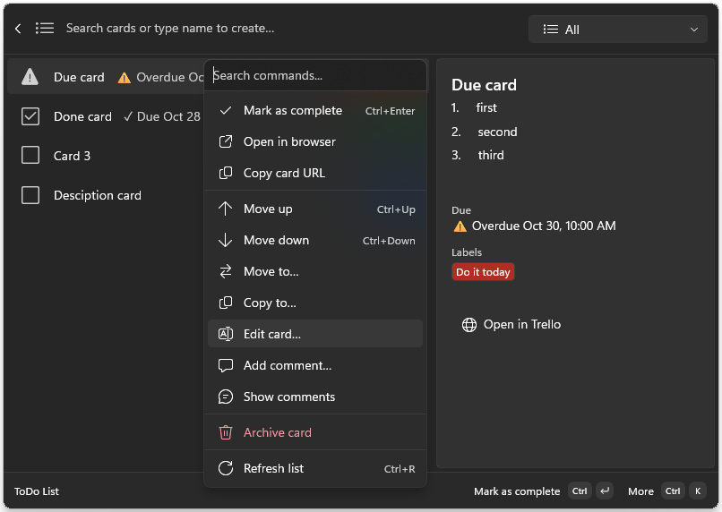

<div align="center">

<p>
	
</p>

<h1 align="center"><span style="font-weight: bold">Trello Extension</span> <br /><span style="font-weight: 300; opacity: 0.5">for Command Palette</span></h1>

<p align="center">
  <a href="https://github.com/BambinoSK/trello-ext-command-palette/blob/main/LICENSE"></a>
  <a href="https://github.com/BambinoSK/trello-ext-command-palette/releases"></a>
  <a href="https://github.com/microsoft/PowerToys"></a>
</p>

</div>

Browse and manage your Trello boards, lists and cards from PowerToys Command Palette, without opening a browser.

> Unofficial. This extension is not affiliated with, endorsed by, or sponsored by Atlassian or Trello. Trello is a trademark of Atlassian.

## Screenshots

**Lists on a board**



**Cards with details, labels and due dates**



**Card actions**



## Features

- **Browse** your boards, lists and cards, with live search on each page
- **Card details** in a side panel: description (Markdown), labels, due date, and optionally checklists, members and attachments
- **Filter** cards: All, Completed, Incomplete, Overdue
- **Create** a card by typing its name in the search box
- **Edit** a card's title and description
- **Mark** cards complete or incomplete
- **Reorder** cards in a list with Move up and Move down
- **Move** a card to another list, or **copy** it to one
- **Comments**: read, add, edit, delete and copy comments
- **Archive** cards, and search archived cards on a board
- **Search** all cards on a board
- **Open** a card in your browser, or copy its URL
- **Pin** boards and lists to the top of Command Palette
- **Dark and light** label colors, following your Windows theme or set by you

### Keyboard shortcuts

| Shortcut | Action |
|---|---|
| `Enter` | Open the selected item (a card opens in Trello) |
| `Ctrl` + `Enter` | Mark the selected card as complete |
| `Ctrl` + `K` | All actions for the selected item |
| `Ctrl` + `Up` / `Down` | Move card up or down |
| `Ctrl` + `R` | Refresh the list |

## Requirements

- Windows 10 (version 2004 or later) or Windows 11, x64 or ARM64
- [PowerToys](https://github.com/microsoft/PowerToys) with Command Palette enabled
- A Trello account

## Install

**Microsoft Store:** coming soon. The Store link will be added here when the listing is live.

After installing, open Command Palette and search for **Trello**.

## Sign in

1. Open Command Palette and choose **Trello**.
2. Choose **Connect to Trello**. Your browser opens Atlassian's sign-in page.
3. Sign in and approve access. The browser returns to your PC and the extension loads your boards.

Your password is entered only on Atlassian's page. The extension never sees it. To sign out, choose **Disconnect Trello**.

## Settings

Open Command Palette settings and select the Trello extension:

| Setting | Default | What it does |
|---|---|---|
| Auto-show card details | On | Opens the detail panel when a card is focused |
| New card position | Top | Where new, copied and moved cards are added to a list |
| Label color theme | Follow system | Light or dark palette for Trello label colors |
| Fetch card checklists | Off | Load checklist items in card details |
| Fetch card members | Off | Load assigned members in card details |
| Fetch card attachments | Off | Load attachments in card details |

The three fetch options are off by default because each one adds requests per card, which can hit Trello's rate limit on large boards.

## Troubleshooting

**Sign-in fails to start with "8756-8759 are all busy"**
The extension needs one free local port from 8756 to 8759 during sign-in. Close the apps using them and try again.

**Sign-in times out**
Finish the approval in the browser window that opened. If you closed it, choose **Cancel sign-in** and connect again.

**"Trello is not connected" or sign-in expires**
Access can expire after a long period of inactivity. Choose **Connect to Trello** again.

**Cards fail to load or are slow**
Trello limits how many requests an app can make. Keep the checklist, member and attachment options off, wait a minute, then use **Refresh list** (`Ctrl` + `R`).

## Privacy

The extension talks only to Trello and Atlassian's sign-in service. It has no analytics or telemetry, and your sign-in tokens are stored in Windows Credential Locker. Details are in [PRIVACY.md](PRIVACY.md).

## Building from source

You need the .NET SDK, Visual Studio with the Windows App SDK workload, and a **client ID** from your own Trello app registration at <https://trello.com/apps/admin>.

The repo contains no client ID. The build resolves `TrelloClientId` in this order:

| Priority | Source | Typical use |
|---|---|---|
| 1 | `-p:TrelloClientId=…` command-line property | CI builds |
| 2 | `TrelloClientId` environment variable | Shell or session override |
| 3 | `client-id.local.props` in the repo root | Everyday local development |
| 4 | Built-in placeholder | No ID configured, the extension shows a setup error at sign-in |

For local development, copy the example file and put your ID in it:

```
cp client-id.local.props.example client-id.local.props
```

Edit `client-id.local.props` and replace `YOUR_TRELLO_OAUTH2_CLIENT_ID_HERE` with your client ID. The file is gitignored, and `dotnet build` picks it up automatically.

Run the tests with:

```
dotnet test TrelloExtension.Tests/TrelloExtension.Tests.csproj
```

## License

[MIT](LICENSE)
